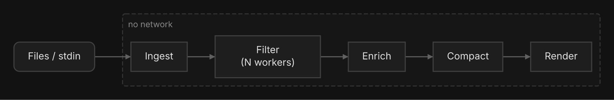

# unlog

[](https://github.com/oxforge/unlog/actions/workflows/ci.yml)
[](https://github.com/oxforge/unlog/actions/workflows/release.yml)
[](https://goreportcard.com/report/github.com/oxforge/unlog)
[](LICENSE)

**Unravel your logs.** A fast CLI tool that ingests raw log files, extracts signal from noise at disk speed, and optionally uses LLMs to produce incident timelines and root cause analysis.

unlog processes logs through a 6-stage streaming pipeline via Go channels with back-pressure:



Stages 1-4 are pure Go with zero network calls, making the core useful without any AI provider. Stage 5 adds optional LLM analysis via OpenAI, Anthropic, Google Gemini, or Ollama.

```
cat /var/log/app/*.log | unlog
unlog --ai-provider openai logs/
```

## Features

- **12 log format parsers** -- JSON, logfmt, CSV, syslog (RFC 3164/5424 and rsyslog's file formats), Apache CLF, Docker JSON, Docker Compose, Kubernetes, CloudWatch, generic timestamped, and raw fallback. Format auto-detected via majority vote.
- **Compressed file support** -- Reads `.gz`, `.tar.gz`, and `.tgz` files transparently.
- **Noise removal** -- Built-in noise patterns (health checks, Prometheus scrapes, k8s internals) plus custom pattern files.
- **One line per error** -- Normalizes UUIDs, IPs, timestamps, and paths to group similar messages; each distinct error per source becomes one line with when it started and stopped and how many times it occurred. The same input always gives the same summary.
- **Burst detection** -- Finds stretches where a source logged far above its normal rate, counted on real event volume, and lists the errors behind each burst.
- **Error chain detection** -- 10 built-in patterns (DB exhaustion, OOM cascade, circuit breaker, deployment failure, disk full, cert expiry, DNS failure, etc.); a chain is reported when at least two of its steps occur, with its errors in order.
- **Deployment markers** -- Deploy, restart and scaling lines are kept at any `--level` and listed before the errors, with how long before the first error the last deploy happened.
- **Token-budgeted compaction** -- Priority-scored entries fit within LLM context windows.
- **LLM analysis** -- Timeline, root cause, and recommendations in a single pass via OpenAI, Anthropic, Google Gemini, or Ollama.
- **Streaming output** -- LLM responses stream to the terminal token-by-token.
- **Multiple output formats** -- Colored terminal, JSON, and Markdown.
- **Stdin support** -- Pipe logs from any source.
- **Importable as a library** -- `types/`, `ingest/`, `filter/`, `enrich/`, and `compact/` are public packages.

## Installation

On macOS or Linux:

```bash
curl -fsSL https://raw.githubusercontent.com/oxforge/unlog/main/install.sh | sh
```

The script downloads the latest release for your system, checks it against the
release's `checksums.txt` and puts `unlog` in `~/.local/bin`; `UNLOG_INSTALL_DIR`
changes the folder. To install a specific version, give the script that version
(`curl -fsSL https://raw.githubusercontent.com/oxforge/unlog/main/install.sh | UNLOG_VERSION=v0.2.2 sh`).
Release archives for every platform, Windows included, are on the
[releases page](https://github.com/oxforge/unlog/releases).

Or, with Go 1.27+ (on any platform):

```bash
go install github.com/oxforge/unlog@latest
```

## Quick start

### Without AI (stages 1-4 only)

Analyze a directory of log files and print a structured summary:

```bash
unlog /var/log/app/
```

Pipe from another command:

```bash
kubectl logs deployment/api --since=1h | unlog
```

### With AI

Set your API key and run:

```bash
export OPENAI_API_KEY=sk-...
unlog --ai-provider openai /var/log/app/
```

Use a different provider:

```bash
export ANTHROPIC_API_KEY=sk-ant-...
unlog --ai-provider anthropic logs/

export GEMINI_API_KEY=AIza...
unlog --ai-provider gemini logs/

# Local models via Ollama (no API key needed)
unlog --ai-provider ollama --model llama3 logs/
```

### Output formats

```bash
# Colored terminal output (default)
unlog logs/

# JSON for CI/CD pipelines
unlog --format json logs/

# Markdown for reports
unlog --ai-provider openai --format markdown --output report.md logs/
```

## Flags

| Flag | Description |
|------|-------------|
| `--ai-provider` | Enable LLM analysis with provider: `openai`, `anthropic`, `gemini`, `ollama` |
| `--model` | Override the default model for the chosen provider |
| `--ai-timeout` | Timeout for LLM API calls (e.g. `2m`, `30s`; default: `5m`) |
| `--format` | Output format: `text`, `json`, `markdown` |
| `--output` | Write output to a file instead of stdout |
| `--level` | Minimum log level: `trace`, `debug`, `info`, `warn`, `error`, `fatal` (default: `warn`) |
| `--since` | Start time filter (ISO 8601 or relative: `2h`, `30m`) |
| `--until` | End time filter (ISO 8601 or relative: `2h`, `30m`) |
| `--noise-file` | Path to a custom noise patterns file |
| `--verbose`, `-v` | Show detailed output including per-filter drop counts |
| `--no-color` | Disable colored output (also respects `NO_COLOR` env var) |
| `--config` | Config file path (default: `~/.unlog/config.toml`) |

## Configuration

Settings are resolved in priority order: **CLI flags > environment variables > config file > defaults**.

### Config file

Create `~/.unlog/config.toml`:

```toml
level = "warn"
format = "text"
ai_provider = ""       # set to "openai", "anthropic", "gemini", or "ollama" to enable AI
model = ""
system_prompt = ""     # custom LLM system prompt (empty = built-in default)
ai_timeout = ""        # timeout for LLM API calls (e.g. "2m", "30s"; default: 5m)
noise_file = ""
verbose = false
no_color = false
```

### Environment variables

Every config option can be set via `UNLOG_*` environment variables:

| Variable | Description |
|----------|-------------|
| `UNLOG_LEVEL` | Minimum log level |
| `UNLOG_FORMAT` | Output format |
| `UNLOG_AI_PROVIDER` | LLM provider (empty = no AI) |
| `UNLOG_MODEL` | Model override |
| `UNLOG_SYSTEM_PROMPT` | Custom LLM system prompt |
| `UNLOG_AI_TIMEOUT` | Timeout for LLM API calls (e.g. `2m`, `30s`) |
| `UNLOG_NOISE_FILE` | Custom noise patterns path |
| `UNLOG_VERBOSE` | Verbose output (`true`/`false`) |
| `NO_COLOR` | Disable color (any value, per [no-color.org](https://no-color.org)) |

### LLM provider API keys

| Provider | Environment variable |
|----------|---------------------|
| OpenAI | `OPENAI_API_KEY` |
| Anthropic | `ANTHROPIC_API_KEY` |
| Gemini | `GEMINI_API_KEY` |
| Ollama | None required (connects to `localhost:11434`) |

## Supported log formats

unlog auto-detects the format of each input file by sampling lines and using majority vote. No configuration needed.

| Format | Example |
|--------|---------|
| **JSON** | `{"level":"error","msg":"timeout","ts":"2024-01-15T10:00:00Z"}` |
| **logfmt** | `ts=2024-01-15T10:00:00Z level=error msg="timeout"` |
| **CSV** | `2024-01-15T10:00:00Z,ERROR,timeout,api` (with header row) |
| **Syslog RFC 3164** | `<131>Jan 15 10:00:00 app-1 myapp[1234]: ERROR timeout` |
| **Syslog files** | `Jan 15 10:00:00 app-1 myapp[1234]: ERROR timeout` or `2024-01-15T10:00:00.123456+00:00 app-1 myapp[1234]: ...` (what rsyslog writes to `/var/log`) |
| **Syslog RFC 5424** | `<165>1 2024-01-15T10:00:00Z host app 1234 - - timeout` |
| **Apache CLF** | `10.0.0.1 - - [15/Jan/2024:10:00:00 -0700] "GET /api HTTP/1.1" 500 789` |
| **Docker JSON** | `{"log":"timeout\n","stream":"stderr","time":"2024-01-15T..."}` |
| **Docker Compose** | `api-1  \| 2024-01-15 10:00:00 ERROR timeout` |
| **Kubernetes** | `2024-01-15T10:00:00.000Z stderr F timeout` |
| **CloudWatch** | `{"@timestamp":"2024-01-15T10:00:00Z","@message":"timeout"}` |
| **Generic** | `2024-01-15 10:00:00 ERROR timeout` |
| **Raw** | Any unstructured text (fallback) |

### Compressed files

| Extension | Handling |
|-----------|----------|
| `.gz` | Decompressed, inner file processed as a single source |
| `.tar.gz`, `.tgz` | Each log file in the archive processed separately |

## Architecture

unlog uses a 6-stage streaming pipeline connected by buffered Go channels:


| Stage | Package | Description |
|-------|---------|-------------|
| 1. Ingest | `ingest/` | Read files, detect format, parse into structured entries |
| 2. Filter | `filter/` | Level filter, time window, noise removal, one record per error, burst detection |
| 3. Enrich | `enrich/` | Error chain detection, deployment events, field extraction |
| 4. Compact | `compact/` | Priority scoring, token-budgeted compaction |
| 5. Analyze | `internal/analyze/` | Optional single-pass LLM analysis |
| 6. Render | `internal/render/` | Terminal, JSON, and Markdown output |

Stages 1-4 are pure Go with no network calls. Stage 5 is optional (enabled with `--ai-provider`). Stages 1-4 are public packages importable as a Go library.

## Custom noise patterns

Create a text file with one pattern per line (case-insensitive substring match). Lines starting with `#` are comments. Patterns apply only to entries below ERROR: an error or fatal entry is always kept, even when its text matches.

```text
# My custom noise patterns
GET /internal/status
connection pool stats
scheduled task completed
cache warmup
```

Use it with `--noise-file`:

```bash
unlog --noise-file my-patterns.txt logs/
```

The built-in patterns cover health checks, Prometheus scrapes, Kubernetes internals, TLS handshakes, connection pool stats, and AWS SDK retries.

## JSON output schema

When using `--format json`, the output includes:

```json
{
  "generated_at": "2024-01-15T12:00:00Z",
  "unlog_version": "1.0.0",
  "model_used": "",
  "analysis_duration_ms": 1234,
  "ai_duration_ms": 0,
  "stats": {
    "ingested": 50000,
    "dropped": 49958,
    "survived": 42,
    "unique_signatures": 40,
    "time_window_start": "2024-01-15T10:00:00Z",
    "time_window_end": "2024-01-15T10:05:00Z",
    "auto_detected_window": false,
    "source_breakdown": { "api.log": 3000, "db.log": 12 },
    "file_count": 0,
    "bytes_processed": 0,
    "duration_ms": 310
  },
  "analysis": "",
  "compacted_summary": "## Incident Overview\n..."
}
```

Every key is always present. `survived` counts the distinct errors (one per source) that reach the summary, and `dropped` includes the merged repeats, so `ingested = dropped + survived`. `source_breakdown` counts ERROR and FATAL occurrences per source. `auto_detected_window` is always `false` (unlog never narrows the time range on its own; use `--since`/`--until`). With `--ai-provider`, `model_used`, `analysis` and `ai_duration_ms` are filled in.

## Development

Needs [just](https://just.systems) (bare `just` lists every recipe) and
optionally [golangci-lint](https://golangci-lint.run).

```bash
just build           # bin/unlog
just install         # go install . into $GOBIN
just test            # all tests, with the race detector
just lint            # golangci-lint
just golden          # rewrite testdata/golden/ after an intended output change
just smoke           # build, then run against testdata/incidents/
just bench           # all benchmarks
just bench-compare   # benchmarks x6 into bench-new.txt, for benchstat
just bigdata         # 100MB synthetic logs in testdata/big/
just clean           # remove bin/ and generated test data
```

To run one package or test: `go test ./ingest/ -run TestIngester`.

### Generating test data

Use `testdata/big/generate.go` to create synthetic log files for benchmarking and manual testing. See its [README](testdata/big/README.md) for usage, flags, and examples.

## License

MIT
